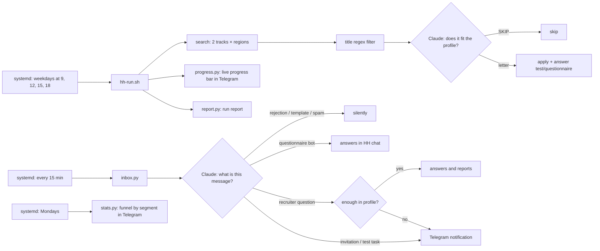

# hh-autopilot

**[Русская версия](README.md)**

An LLM-powered job-search autopilot for hh.ru, the largest job board in Russia. It runs on a VPS on a schedule and:

- finds fresh vacancies;
- decides whether each one fits the candidate;
- writes a cover letter tailored to each vacancy;
- fills in employer questionnaires;
- answers recruiter bots and human recruiters in HH chats;
- sends to Telegram only what needs a human decision.

It is built on top of [hh-applicant-tool](https://github.com/s3rgeym/hh-applicant-tool), which provides access to the HH API and web. The model is Claude, connected through a local OpenAI-compatible shim. The candidate profile is a plain text file, and the model relies on it alone.

## Metrics

A real account: a QA engineer with 5 years of experience. The numbers are computed by `stats.py` from the HH API.

| | Before (by hand and simple scripts) | Autopilot, first 17 days |
|---|---|---|
| Applications | 5677 | 452 |
| Applications per active day | ≈19 | ≈34 |
| Invitations, % of all applications | 7.2% | 6.6% |
| Invitations, % of employers who replied | 16% | 17% |
| Candidate's time | hours a day | reading Telegram notifications |

From the server run logs (34 runs):

- 157 applications sent;
- **177 vacancies rejected by the model as a poor fit for the profile.** That is more than half of what the search returns: "product quality" inspection at a factory, lead roles in test automation, "AI trainers" that turn out to be sales jobs, and so on;
- 72 vacancies cut by a title regex before reaching the model;
- 6 recruiter-bot questionnaires filled in chats automatically.

**The honest takeaway.** The invitation rate stayed at the level of manual applications. The autopilot wins on volume, on reacting to fresh vacancies quickly, and on not spending a human's time. It does not improve the hit rate: the ceiling there is set by the market and the resume.

## How it works



| File | What it does |
|---|---|
| `hh-run.sh` | One run: bumps the resumes, checks that Claude is available (waits up to 6 h for a rate-limit reset), runs the search passes (remote, Serbia, office in Moscow and St. Petersburg) with retries on network failures, sends a report |
| `claude_shim.py` | `/v1/chat/completions` on top of `claude -p`: hh-applicant-tool talks to a Claude subscription as if it were the OpenAI API |
| `claude_wait.py` | Parses "resets 2:50pm" from the rate-limit error and computes how long to wait |
| `feedback.py` | Classifies employer replies, fills bot questionnaires, answers recruiters |
| `inbox.py` | Every 15 minutes: new messages, daily reminders about chats waiting for a reply, HH web-session check |
| `progress.py` | A live Telegram message with run progress |
| `report.py` | Final report: where it applied (remote/office), employer replies, errors |
| `captcha_check.py` | Pre-flight check: if HH asks for a captcha, the run stops and sends an alert; after the captcha is solved, the run is started manually |
| `stats.py` | The application funnel for the metrics above; `--week` sends segments (resume, remote/office, level, QA/AI) to Telegram |
| `abroad.py` | Weekdays: remote jobs worldwide (LinkedIn, Remote OK, Remotive, Himalayas, Working Nomads), vacancies in Serbia (Infostud, LinkedIn) and Thailand (LinkedIn). Claude assesses each one and writes a short summary and a cover letter; if the posting has an email, it sends the PDF resume itself, otherwise it sends an apply link |
| `patches/` | Changes to hh-applicant-tool (see below) |

### What was added to hh-applicant-tool

- `--candidate-profile`: the letter is generated from the **full** vacancy (city, format, skills, text) and the candidate profile, not from a template.
- The model can answer `SKIP`, and then no application is sent. So the same call doubles as a relevance filter.
- Employer questions and tests are answered from the profile. If the model picks none of the offered options, the application is not sent, instead of answering the first option at random.
- `--excluded-title`: a regex filter on the vacancy title; `--experience` accepts multiple values.
- A `chat` command (`list` / `data` / `send`) for HH chats, including bot buttons.

## What the funnel analysis showed

`stats.py` segments after the first 17 days:

| Segment | Invitations |
|---|---|
| Vacancies with "Middle" in the title | 20% |
| Senior / Lead | 4% |
| Second resume (Moscow, salary in rubles) | 15% (sample of 39) |
| Main resume | 6% |

What changed as a result:
- Russian remote vacancies always go from the second resume (Moscow, salary in rubles), the rest from the main one. The resume comparison arrives in Telegram every Monday.
- Senior and Lead are not filtered out: the invitation rate is lower, but an application costs nothing.
- Runs on weekdays at 9, 12, 15 and 18: the application lands in the first hours after publication, and HH sees no excess load (hourly runs plus bulk requests led to a captcha on applications). If there are no applications and no news, no Telegram message is sent.

## Principles

- **No made-up facts.** The model knows only what is in the profile. What the candidate lacks, it frames as a growth area instead of inventing experience.
- **A human decides where there is risk.** Interview times, test tasks, external links, offer terms: all of these go to Telegram instead of being handled automatically.
- **Good news only.** Rejections and template messages are not forwarded. Reminders about chats waiting for a reply come once a day and stop after 3 days.
- **Resilience.** Retries on HH and VPN failures. Waiting for the Claude rate limit to reset. A failed auto-reply is retried up to 3 times. Once an hour it checks whether HH dropped the login, and alerts if so.

## Limitations

- Mass auto-applying is a grey area of HH's rules. The account may be restricted. Use at your own risk.
- The shim uses a personal Claude Code subscription and is meant for a single user. A service would need an API key.
- HH periodically resets the web session: logging in again is done manually with a code from email.
- HH answers hundreds of consecutive vacancy-card requests with a captcha. That is why `stats.py` takes the work format from logs, and each run checks for a captcha before applying.
- Parsing the HH web UI and employer bots (e.g. Sber's GigaRecruiter) breaks with every interface change.

## Installation

```bash
git clone https://github.com/s3rgeym/hh-applicant-tool
git -C hh-applicant-tool checkout 6c51d79
git -C hh-applicant-tool apply ../patches/hh-applicant-tool.patch
cp patches/chat.py hh-applicant-tool/src/hh_applicant_tool/operations/
python3 -m venv .venv && .venv/bin/pip install -e ./hh-applicant-tool
.venv/bin/hh-applicant-tool authorize you@example.com   # the code arrives by email

cp examples/autopilot.env autopilot.env                       # resume IDs, regions, contact
cp examples/telegram.env telegram.env                         # bot for reports
cp examples/profile.example.txt profile.txt                   # profile, truth only
cp examples/profile.example.txt profile_office.txt            # profile for the second resume
cp examples/excluded_employers.txt .
claude setup-token > claude.env                               # long-lived Claude Code token

./hh-run.sh --dry-run                                         # dry run without applying
sudo cp systemd/* /etc/systemd/system/ && sudo systemctl enable --now hh-run.timer hh-inbox.timer hh-resume.timer hh-stats.timer
```

Paths and user in `systemd/*.service` are set to `/home/hh/hh-autoapply` and `hh`; adjust them for your setup. For macOS there is `launchd/install-schedule.sh`.

## License

MIT for the code in this repository. hh-applicant-tool has its own terms of use.
