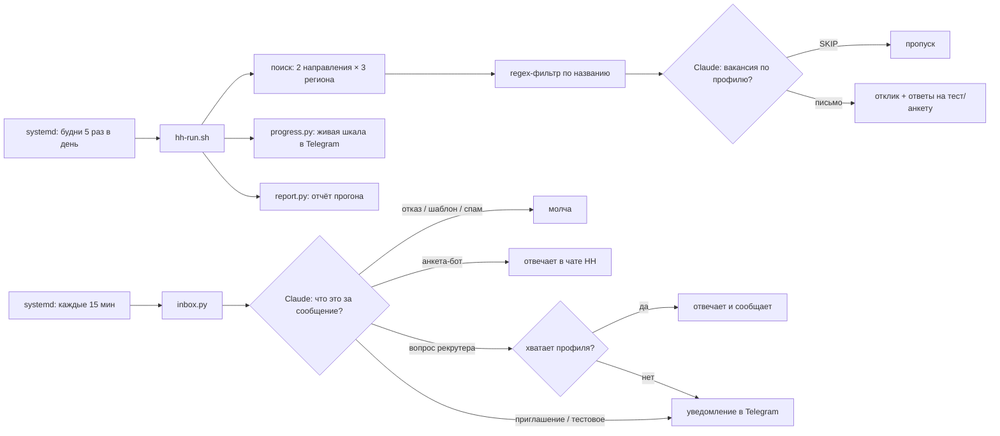

# hh-autopilot

Автопилот поиска работы на hh.ru на основе LLM. Он работает на VPS по расписанию и делает следующее:

- находит свежие вакансии;
- решает, подходят ли они кандидату;
- пишет сопроводительное письмо под каждую вакансию;
- заполняет анкеты работодателей;
- отвечает ботам-рекрутерам и живым рекрутерам в чатах HH;
- присылает в Telegram только то, что требует решения человека.

Это надстройка над [hh-applicant-tool](https://github.com/s3rgeym/hh-applicant-tool), который даёт доступ к API и вебу HH. Модель — Claude, подключённая через локальный OpenAI-совместимый шим. Профиль кандидата задаётся текстовым файлом, и модель опирается только на него.

## Метрики

Реальный аккаунт, QA-инженер с опытом 5 лет. Цифры считает `stats.py` по API HH.

| | Раньше (вручную и простыми скриптами) | Автопилот, первые 17 дней |
|---|---|---|
| Откликов | 5677 | 452 |
| Откликов в активный день | ≈19 | ≈34 |
| Приглашений от всех откликов | 7,2% | 6,6% |
| Приглашений от ответивших работодателей | 16% | 17% |
| Время кандидата | часы в день | разбор уведомлений в Telegram |

По логам прогонов на сервере (34 прогона):

- 157 откликов отправлено;
- **177 вакансий модель отсеяла как не подходящие профилю.** Это больше половины того, что находит поиск: тестирование «качества продукции» на заводе, лидские роли в автоматизации, «AI-тренеры», которые на деле продажи, и так далее;
- 72 вакансии отсечены regex-фильтром по названию ещё до модели;
- 6 анкет ботов-рекрутеров заполнено в чатах автоматически.

**Честный вывод.** Доля приглашений осталась на уровне ручных откликов. Автопилот выигрывает объёмом, скоростью отклика на свежие вакансии и тем, что не тратит время человека. Качество попадания он не улучшает: потолок тут задают рынок и резюме.

## Как устроено



| Файл | Что делает |
|---|---|
| `hh-run.sh` | Один прогон: поднимает резюме, проверяет доступность Claude (ждёт сброса лимита до 6 ч), делает 6 проходов поиска с повторами при сетевых сбоях, отправляет отчёт |
| `claude_shim.py` | `/v1/chat/completions` поверх `claude -p`: hh-applicant-tool работает с подпиской Claude как с OpenAI API |
| `claude_wait.py` | Парсит «resets 2:50pm» из ошибки лимита и считает, сколько ждать |
| `feedback.py` | Классифицирует ответы работодателей, заполняет анкеты ботов, отвечает рекрутерам |
| `inbox.py` | Каждые 15 минут: новые сообщения, ежедневные напоминания о чатах, где ждут ответа, проверка веб-сессии HH |
| `progress.py` | Живое сообщение в Telegram с прогрессом прогона |
| `report.py` | Итоговый отчёт: куда откликнулся (удалёнка/офис), ответы работодателей, ошибки |
| `stats.py` | Воронка откликов для метрик выше |
| `patches/` | Доработки hh-applicant-tool (подробнее ниже) |

### Что добавлено в hh-applicant-tool

- `--candidate-profile` — письмо генерируется по **полному** описанию вакансии (город, формат, навыки, текст) и профилю кандидата, а не по шаблону.
- Модель может ответить `SKIP`, и тогда отклика не будет. Так модель одновременно служит фильтром релевантности.
- Ответы на вопросы и тесты работодателя идут по профилю. Если модель не выбрала ни один из предложенных вариантов, отклик не отправляется, а не отвечается наугад первым вариантом.
- `--excluded-title` — regex-фильтр по названию вакансии; `--experience` принимает несколько значений.
- Команда `chat` (`list` / `data` / `send`) для работы с чатами HH, включая кнопки ботов.

## Принципы

- **Никаких выдумок.** Модель знает только то, что записано в профиле. Чего у кандидата нет, она называет направлением роста, а не придумывает опыт.
- **Человек решает, где есть риск.** Время созвона, тестовые задания, внешние ссылки, условия оффера — всё это уходит в Telegram, а не обрабатывается автоматически.
- **Только хорошие новости.** Отказы и шаблонные сообщения не присылаются.
- **Отказоустойчивость.** Повторы при сбоях HH и VPN. Ожидание сброса лимита Claude. Неудавшийся автоответ повторяется до 3 раз. Раз в час проверяется, не сбросил ли HH вход, и при сбросе приходит тревога.

## Ограничения

- Массовые автоотклики — серая зона правил HH. Аккаунт могут ограничить. Используйте на свой риск.
- Шим использует личную подписку Claude Code и рассчитан на одного пользователя. Для сервиса нужен API-ключ.
- HH периодически сбрасывает веб-сессию: вход заново делается вручную по коду из почты.
- Парсинг веба HH и боты работодателей (например, GigaRecruiter Сбера) ломаются при каждом изменении интерфейса.

## Установка

```bash
git clone https://github.com/s3rgeym/hh-applicant-tool
git -C hh-applicant-tool checkout 6c51d79
git -C hh-applicant-tool apply ../patches/hh-applicant-tool.patch
cp patches/chat.py hh-applicant-tool/src/hh_applicant_tool/operations/
python3 -m venv .venv && .venv/bin/pip install -e ./hh-applicant-tool
.venv/bin/hh-applicant-tool authorize you@example.com   # код придёт на почту

cp examples/autopilot.env autopilot.env                       # ID резюме, регионы, контакт
cp examples/telegram.env telegram.env                         # бот для отчётов
cp examples/profile.example.txt profile.txt                   # профиль, только правда
cp examples/profile.example.txt profile_office.txt            # профиль для второго резюме
cp examples/excluded_employers.txt .
claude setup-token > claude.env                               # долгоживущий токен Claude Code

./hh-run.sh --dry-run                                         # пробный прогон без откликов
sudo cp systemd/* /etc/systemd/system/ && sudo systemctl enable --now hh-run.timer hh-inbox.timer hh-resume.timer
```

Пути и пользователь в `systemd/*.service` указаны как `/home/hh/hh-autoapply` и `hh`, поправьте их под себя. Для macOS есть `launchd/install-schedule.sh`.

## Лицензия

MIT — для кода этого репозитория. У hh-applicant-tool собственные условия использования.
